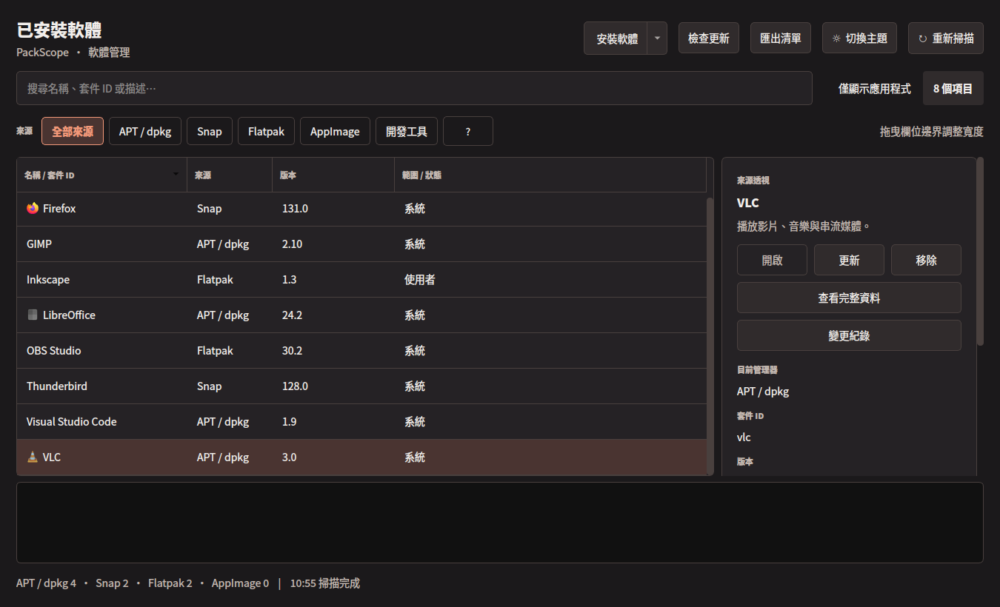

<p align="center">
  <picture>
    <source media="(prefers-color-scheme: dark)" srcset="assets/packscope-logo-dark.svg">
    
  </picture>
</p>

<p align="center"><strong>讓 Ubuntu 上的軟體與套件，一目了然。</strong></p>

PackScope 是面向 Ubuntu 桌面的**應用程式優先軟體管理介面**。它集中呈現本機已安裝或偵測到的項目，幫你看出軟體由 APT、Snap、Flatpak、AppImage 或開發工具中的哪一種方式管理，再透過對應工具執行安裝、更新及移除。PackScope 不取代這些套件管理器，也不把「偵測到的檔案」誤當成「已安裝的套件」。

<p align="center">
  
  <br><sub>介面預覽，使用示意資料。</sub>
</p>

## 從應用程式出發，掌握不同安裝來源

- **集中查看不同來源**：瀏覽 APT / dpkg、Snap、Flatpak、AppImage，以及 pipx、npm global 和 Cargo 的本機項目；可依來源篩選和搜尋名稱、套件 ID 或描述。
- **更快找到應用程式**：預設只顯示可辨識的應用程式，來源按鈕顯示目前篩選下的數量；取消「僅顯示應用程式」即可查看全部套件。篩選可能因來源資料不完整而有遺漏。
- **從本機安裝檔開始**：開啟 `.deb`、`.snap`、`.flatpak`、`.flatpakref` 或 `.AppImage`，PackScope 依副檔名選擇安裝方式，顯示來源及確認視窗後才執行。可在程式內選檔，或在檔案管理員將 PackScope 設為開啟程式後雙擊；也能依套件名稱安裝。
- **按需更新**：檢查 APT、Flatpak 與 Snap 的更新，選擇單一或多個已辨識項目執行；也能重新取得 APT 和 Flatpak 的來源資訊。
- **作業狀態看得見**：在下方輸出區查看指令與即時結果；管理器提供進度時顯示進度，否則顯示執行中狀態。輸出保留於目前執行期間。
- **依你的習慣調整**：支援深色、淺色及自訂配色；清單欄寬、詳細資料面板、輸出區大小、來源與搜尋篩選也會保留到下次啟動。

## 安裝與啟動

目前為 **0.2.0 開發版**，主要針對 Ubuntu 24.04；其他環境尚未完整驗證。使用各種來源時，也需要對應的系統套件管理器。GitHub 現有的 `v0.2.0-dev.1` 發行版 DEB 早於主線的雙擊安裝檔功能；需要該功能請從目前原始碼建置安裝。

### 從目前原始碼建置（含雙擊安裝檔功能）

需要 Python 3.11 以上及 `dpkg-deb`。在 Ubuntu 上執行：

```bash
git clone https://github.com/Alexchen93/PackScope.git
cd PackScope
sh packaging/build-deb.sh
sudo apt install --reinstall ./dist/packscope_0.2.0~dev1_all.deb
```

安裝後可從應用程式選單開啟 **PackScope**，或在終端機執行 `packscope`。在檔案管理員可將 PackScope 指定為支援安裝檔的預設開啟程式；安裝套件不會擅自覆蓋你原有的預設程式。

### 下載既有發行版（不含最新雙擊開檔功能）

1. [下載 PackScope DEB 安裝檔](https://github.com/Alexchen93/PackScope/releases/download/v0.2.0-dev.1/packscope_0.2.0.dev1_all.deb)。
2. 在檔案管理員中用軟體安裝程式開啟下載的 `.deb`，依畫面提示安裝。若系統沒有提供此選項，可在下載資料夾開啟終端機執行：

   ```bash
   sudo apt install ./packscope_0.2.0.dev1_all.deb
   ```

3. 安裝後，從應用程式選單開啟 **PackScope**，或在終端機執行 `packscope`。安裝時套件管理器會處理所需的系統依賴。

若只想從原始碼執行，請先安裝 Python、PyQt5、python3-gi 與專案相依套件，再執行 `./packscope.sh`。

## 使用提示

- 「安裝軟體」按鈕可選擇本機安裝檔；按按鈕右側箭頭可依名稱安裝。
- 在檔案管理員雙擊支援的安裝檔並選擇 PackScope，程式會辨識格式並顯示安裝確認，不會直接跳過確認執行。
- 按「檢查更新」後可勾選項目更新。APT 與 Flatpak 平常使用本機資料，Snap 會連線查詢；AppImage 與開發工具尚未納入統一更新查詢。
- AppImage 會區分 PackScope 管理的項目與偵測到的檔案；目前掃描 `~/Applications`、`~/AppImages`、`~/Downloads` 第一層，以及現有管理紀錄。
- APT 清單也包含系統程式庫，Flatpak 也可能包含執行環境；「僅顯示應用程式」是依可用資料辨識的篩選，不保證完整。PackScope 目前不是遠端軟體商店的完整目錄瀏覽器。
- 需要系統權限時，會由桌面環境顯示授權視窗。清單中的來源表示目前的管理方式。

更多操作細節、支援範圍與測試狀態請參考 [使用說明](packscope/README.md)及[操作與驗證說明](packscope/SAFETY.md)。

## 測試

在已安裝 PyQt5 等相依套件的環境中執行：

```bash
QT_QPA_PLATFORM=offscreen python3 -m unittest discover -s tests -p 'test_packscope*.py'
```

## 授權

請見 [LICENSE](LICENSE)。
